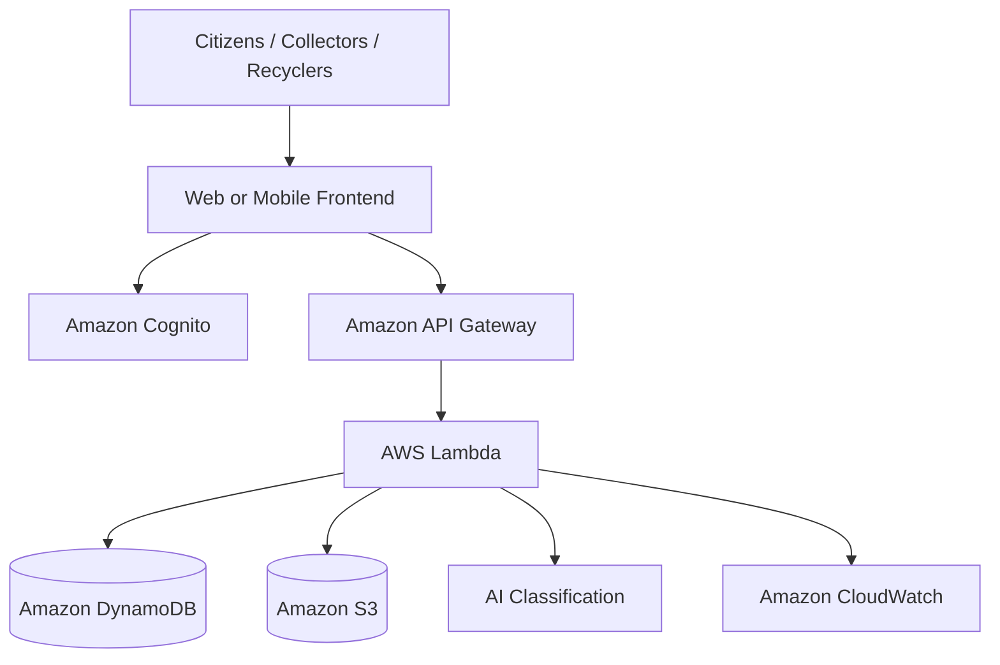

# ♻️ EcoLoop AI
### AI-Powered Waste Segregation, Collection & Recycling Platform

> **WASTE IS A RESOURCE OUT OF PLACE.**
>
> Identify it. Collect it. Route it. Recover it.

**EcoLoop AI**, developed by **Team DevX**, is an AI-powered sustainability platform designed to connect citizens, waste collectors, and recycling partners. It aims to simplify waste identification, improve collection coordination, and make recyclable materials easier to track throughout their journey.


---
## 🖇️ Use it on mobile (Deployed)

<https://ecoloop-ai.netlify.app/>

## 🌍 About the Project

Waste management is one of the major environmental challenges facing modern cities. Incorrect segregation, inefficient collection workflows, and disconnected recycling networks often prevent valuable materials from being recovered effectively.

EcoLoop AI explores how Artificial Intelligence, cloud computing, and digital coordination can transform waste management into a more connected and transparent process.

The platform is designed to help users identify waste categories, understand appropriate disposal methods, schedule pickups, connect with recycling partners, and track material movement from collection to processing.

Our vision is to move beyond waste disposal and encourage a **circular economy where materials are treated as valuable resources rather than unwanted waste.**

## 🚨 Problem Statement

Traditional waste-management workflows face several challenges:

- **Incorrect Segregation:** People often struggle to identify the appropriate category and disposal method for different waste materials.
- **Inefficient Collection:** Pickup requests, collection schedules, and collector assignments can be difficult to coordinate.
- **Disconnected Recycling Networks:** Suitable recycling facilities may be difficult to identify based on material type, quantity, and acceptance requirements.
- **Limited Traceability:** Collection does not necessarily mean that waste reaches a recycler or gets processed.
- **Lack of Transparency:** Communities need better visibility into collection activity, material acceptance, and verified recycling outcomes.

EcoLoop AI addresses these challenges through a unified, technology-driven waste-management workflow.

## 💡 Our Solution

EcoLoop AI brings together waste identification, collection coordination, recycling connectivity, and material traceability.

### 1. AI-Assisted Waste Identification
Users can upload or capture an image of waste and receive a predicted category with disposal guidance through an image-classification workflow.

### 2. Smart Waste Segregation
The platform is designed to organize waste into categories such as:
- Wet and biodegradable waste
- Dry recyclable materials
- Electronic waste and batteries
- Hazardous waste
- Reusable textiles

Actual disposal recommendations should follow local rules and facility acceptance requirements.

### 3. Pickup Scheduling
Users can submit pickup requests with material details, estimated quantity, location, and preferred collection time.

### 4. Recycler Connectivity
The platform aims to connect suitable materials with recycling partners based on accepted material categories, quantity, location, capacity, and quality requirements.

### 5. Material Traceability
Waste can be tracked through distinct workflow stages:

`REQUESTED → ASSIGNED → COLLECTED → DISPATCHED → RECEIVED → PROCESSED`

Each stage should be recorded and verified appropriately. A collected item must not automatically be treated as successfully recycled.

---

## ✨ Key Features

- AI-assisted waste image classification
- Waste-category identification and disposal guidance
- Pickup request and collection workflow
- Recycler discovery and material matching
- Collection and transfer status tracking
- Role-based experiences for citizens, collectors, recyclers, and administrators
- Dashboard and activity monitoring
- Potential integration of verified collection rewards
- AWS-based serverless architecture
- Scalable foundation for future sustainability applications

*Feature availability depends on the current implementation. Planned or simulated features should be clearly labelled in the demo.*

---

## 🎥 Project Demo

### ▶️ Watch the Live Project Demo: "EcoLoop AI — YouTube Demo" <https://youtu.be/Agstru_KtRU/>

See EcoLoop AI in action and explore its features, workflow, and implementation.

## 📝 Project Blog

### 📖 Read the AWS Builder Blog: "EcoLoop AI — Project Blog" <https://builder.aws.com/content/3KXfDqghLRDMVwepKizRDJRnhRq/ecoloopai/>

Explore the inspiration, technical approach, and development journey behind EcoLoop AI.


## 🖼️ Application Screenshots

Screenshots below should be captured from the actual running application and saved in `docs/screenshots/`.

### 🏠 Homepage


*An overview of EcoLoop AI, its mission, and its waste-management workflow.*

### 🤖 AI Waste Scanner

*The interface for uploading waste images and displaying classification results.*

### 📊 Citizen Dashboard


*An overview of user activity, pickup requests, and material status.*

### 🚚 Pickup Booking


*The pickup-request experience for coordinating waste collection.*

### ♻️ Recycling Partner Marketplace


*An interface for discovering suitable recycling partners and their material requirements.*

### 📈 Admin Dashboard


*Operational monitoring for collection requests, material transfers, and recycling workflows.*

### ☁️ AWS Architecture


*The proposed cloud architecture supporting EcoLoop AI.*


---

## 🏗️ System Architecture

EcoLoop AI follows a modular architecture that separates the frontend, backend processing, data storage, authentication, and AI classification.



The diagram represents the intended AWS architecture. Actual integrations depend on the services configured and tested in the project.

---

## ☁️ How We Use AWS

AWS provides the proposed cloud foundation for EcoLoop AI, supporting backend processing, data storage, authentication, image handling, monitoring, and AI integration.

### 1. Amazon API Gateway

**Purpose:** Provides an API entry point for application requests.

API Gateway can receive requests from the frontend and route them to backend functions. In EcoLoop AI, it can support operations such as creating pickup requests, retrieving collection status, and submitting waste images for classification.

**Benefit:** Provides a managed API layer without requiring the team to maintain a conventional always-running API server.

### 2. AWS Lambda

**Purpose:** Executes backend business logic in response to requests and configured events.

Lambda functions can validate pickup requests, check authorization, update workflow statuses, interact with the database, and coordinate classification requests.

**Benefit:** Supports an event-driven, serverless architecture that reduces infrastructure-management overhead.

### 3. Amazon DynamoDB

**Purpose:** Stores structured application records using a managed NoSQL database.

Potential records include:
- User and role references
- Pickup requests
- Material batches
- Collection status
- Recycler information
- Transfer and receipt records
- Classification metadata

For example, when a pickup request is created, the backend can validate it and store its details in DynamoDB. Subsequent collection and transfer events can update the corresponding records.

**Benefit:** Provides managed storage that can scale with application demand when the data model and access patterns are designed appropriately.

### 4. Amazon S3

**Purpose:** Stores waste images and supporting collection evidence.

S3 can store uploaded images separately from structured database records. The application can maintain a reference to each image and allow authorized backend workflows to access it for classification or verification.

**Benefit:** Provides durable object storage for image-based workflows.

### 5. Amazon Cognito

**Purpose:** Supports user authentication and identity management.

Cognito can provide sign-up and sign-in capabilities and supply identity tokens for authenticated requests. Backend authorization can then determine whether a citizen, collector, recycler, or administrator is permitted to perform a particular action.

**Benefit:** Reduces the need to build authentication infrastructure from scratch.

Authentication and authorization are different: the backend must still enforce permissions for protected operations.

### 6. Amazon Rekognition Custom Labels

**Purpose:** Supports custom image recognition using a model trained for specific categories.

For EcoLoop AI, a custom model could classify waste images into selected material categories. This requires a suitable labelled dataset, model training, validation, and a configured inference workflow.

Predictions with insufficient confidence should be sent for manual confirmation rather than treated as certain results.

**Benefit:** Provides a managed route toward custom image classification without building the entire computer-vision infrastructure independently.

### 7. Amazon CloudWatch

**Purpose:** Supports logging and monitoring for configured AWS resources.

CloudWatch can help developers investigate Lambda errors, review application logs, monitor operational metrics, and configure alarms.

**Benefit:** Improves troubleshooting and visibility into backend behavior.

### 8. AWS Serverless Application Model (AWS SAM)

**Purpose:** Defines and deploys serverless infrastructure through configuration templates.

AWS SAM can be used to describe Lambda functions, API events, permissions, and supported AWS resources as code. These definitions can be maintained alongside application source code.

**Benefit:** Helps make infrastructure easier to review, version, and reproduce.

### 🔄 Example AWS Request Flow

1. A citizen submits a pickup request from the frontend.
2. The frontend sends the request to the configured API endpoint.
3. API Gateway routes the request to an AWS Lambda function.
4. Lambda validates the input and checks authorization.
5. The backend stores the request in DynamoDB.
6. CloudWatch records configured logs and monitoring information.
7. The API returns a response to the frontend.
8. Later collection and recycler updates are recorded as separate workflow events.

This flow requires the relevant services, permissions, and application integrations to be configured and tested before it can be considered operational.

### 💰 Cost and Security Considerations

- Use least-privilege IAM permissions.
- Keep S3 buckets private by default.
- Never expose AWS secret keys in frontend code.
- Configure budget alerts and review service usage.
- Monitor image storage and AI inference costs.
- Avoid leaving paid AI model deployments running unnecessarily.
- Protect personal information and collection addresses.
- Clearly distinguish deployed services from planned integrations.

---

## 🧰 Technology Stack

| Layer | Technology | Purpose |
|---|---|---|
| Frontend | React / TypeScript, if present | User interface |
| Development tooling | Vite | Frontend development and build tooling |
| Backend | Actual server runtime used by the project | Business logic and APIs |
| API | Amazon API Gateway, if integrated | API routing |
| Compute | AWS Lambda, if integrated | Serverless processing |
| Database | Amazon DynamoDB, if integrated | Application records |
| Object storage | Amazon S3, if integrated | Images and evidence |
| Authentication | Amazon Cognito, if integrated | User identity |
| AI | Amazon Rekognition Custom Labels, if trained and integrated | Custom image classification |
| Monitoring | Amazon CloudWatch, if configured | Logs and metrics |
| Infrastructure | AWS SAM, if used | Infrastructure as code |

---

## 🔐 Security and Responsible AI

EcoLoop AI is designed around responsible data handling and transparent classification.

- Protect authentication credentials and API secrets.
- Enforce role permissions on the backend.
- Validate uploaded files and request data.
- Restrict access to personal information and stored images.
- Handle uncertain AI predictions with manual review.
- Follow local waste-management and recycling requirements.
- Keep collection, recycler receipt, and processing records distinct.
- Label demo data and estimated impact metrics clearly.

AI can assist waste identification, but it cannot independently guarantee that a material is recyclable or that it has been processed.

---

## 🚀 Getting Started

### Prerequisites

- Git
- A compatible Node.js version
- Bun, if the project uses `bun.lock`
- AWS CLI and AWS SAM CLI only if deploying the AWS infrastructure

### Clone the Repository

```bash
git clone https://github.com/YOUR-USERNAME/ecoloop-ai.git
cd ecoloop-ai
```

Replace `YOUR-USERNAME` with your actual GitHub username.

### Install Dependencies

If the project uses Bun:

```bash
bun install
```

Alternatively, if the project uses npm:

```bash
npm install
```

### Configure Environment Variables

Create a local `.env` file from `.env.example` if the project requires it.

```bash
cp .env.example .env
```

On Windows PowerShell:

```powershell
Copy-Item .env.example .env
```

Add the required values locally. Never commit real credentials.

### Run the Application

Check `package.json` for the scripts supported by the project. A typical Vite development command is:

```bash
bun run dev
```

Or, when using npm:

```bash
npm run dev
```

Open the local URL printed in the terminal.

### Build the Application

Use the build script configured in `package.json`, for example:

```bash
bun run build
```

or:

```bash
npm run build
```

---

## 📁 Project Structure

```text
ecoloop-ai/
├── src/                     # Application source code
├── server                  # Backend entry point; verify actual file type
├── docs/
│   └── screenshots/        # Product and architecture images
├── .env.example            # Placeholder configuration
├── .gitignore
├── bun.lock                # Dependency lockfile, if used
├── index.html
├── package.json
├── README.md
├── tsconfig.json
└── vite.config.ts
```

Adjust this structure to match the actual repository.

---

## 👥 Team DevX

**Team DevX** is working on EcoLoop AI to explore how artificial intelligence and cloud computing can support more connected and transparent waste management.

### ⭐Lead Adarsh Chaudhary — Project Direction and System Design
- Defined the project vision and problem statement.
- Coordinated responsibilities and development priorities.
- Guided system workflow and architecture discussions.
- Aligned the team's efforts with sustainability goals.
- Coordinated project documentation and presentation.

### Vipin kumar — Frontend and User Experience
- Contributed to the design and implementation of user-facing interfaces.
- Worked on responsive layouts and application navigation.
- Helped develop waste identification, pickup, and recycler workflows.
- Coordinated frontend requirements with backend integration.

### Adhyan & Adarsh — Backend, Cloud, and AI Integration
- Contributed to backend workflow and data-model planning.
- Helped design API and cloud-service integration.
- Explored the image-classification workflow.
- Considered access control, traceability, monitoring, and cost management.

Update these descriptions with each member's actual work and add names or profile links as appropriate.

---

## 🗺️ Future Roadmap

- [ ] Complete and verify the core pickup workflow.
- [ ] Configure authentication and backend role authorization.
- [ ] Validate the AI classifier with representative test data.
- [ ] Add QR-based batch tracking.
- [ ] Explore collector route optimization.
- [ ] Support regional languages for disposal guidance.
- [ ] Add offline-tolerant collector workflows.
- [ ] Introduce verified rewards for eligible collection events.
- [ ] Improve recycler matching and material acceptance checks.
- [ ] Add tests, monitoring, and deployment documentation.
- [ ] Validate impact reporting against recorded evidence.

---

## 🧠 Challenges and Learnings

Developing EcoLoop AI highlights the importance of connecting user experience, cloud infrastructure, AI predictions, and real-world operational requirements.

Key lessons include:

- AI predictions need suitable datasets, evaluation, and uncertainty handling.
- Serverless systems still require careful permissions, monitoring, and error handling.
- Material traceability depends on reliable status transitions and evidence.
- Authentication alone does not replace backend authorization.
- Recycling recommendations must consider local rules and facility requirements.
- Environmental impact should be based on evidence rather than unsupported claims.

These principles help guide the project toward a practical and responsible sustainability solution.

---

## 🌱 Future Vision

EcoLoop AI aims to support a more circular approach to resource management by helping people identify materials, coordinate collection, and connect recoverable waste with suitable recycling partners.

By combining AI-assisted identification with a modular cloud architecture, the project explores how technology can support more transparent waste workflows and better-informed decisions.

The long-term goal is to help make responsible waste management easier for communities, collection teams, and recycling networks.

---

## 🤝 Contributing

Contributions and constructive feedback are welcome.

1. Fork the repository.
2. Create a feature branch.
3. Make and test your changes.
4. Commit with a clear message.
5. Open a pull request explaining the change.

Please ensure that documentation and screenshots reflect the actual state of the application.

---

## 📜 License

Add a `LICENSE` file if you intend to publish the project under an open-source license. Until a license is chosen, do not assume others have permission to reuse the code.

---

## ⭐ Support EcoLoop AI

If you find this project interesting, star the repository and share feedback to help us improve.

## 🔗 Contact Me

You can contact me:

<https://www.linkedin.com/in/adarsh-chaudhary-071053331/>


<https://youtube.com/@adarsh_dx?si=a1uCA1LcQjs2ZlF3/>


<p align="center">
  <strong>EcoLoop AI — Identify it. Collect it. Route it. Recover it.</strong><br/>
  <em>Built by Team DevX for a more sustainable future.</em>
</p>
